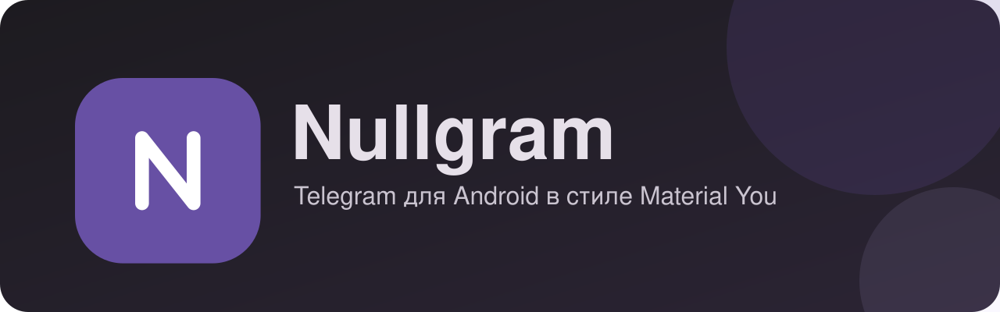
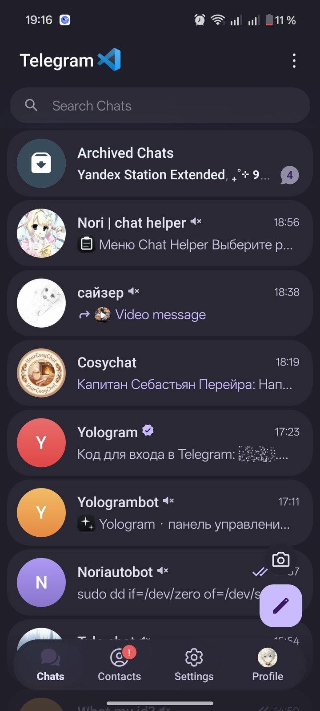
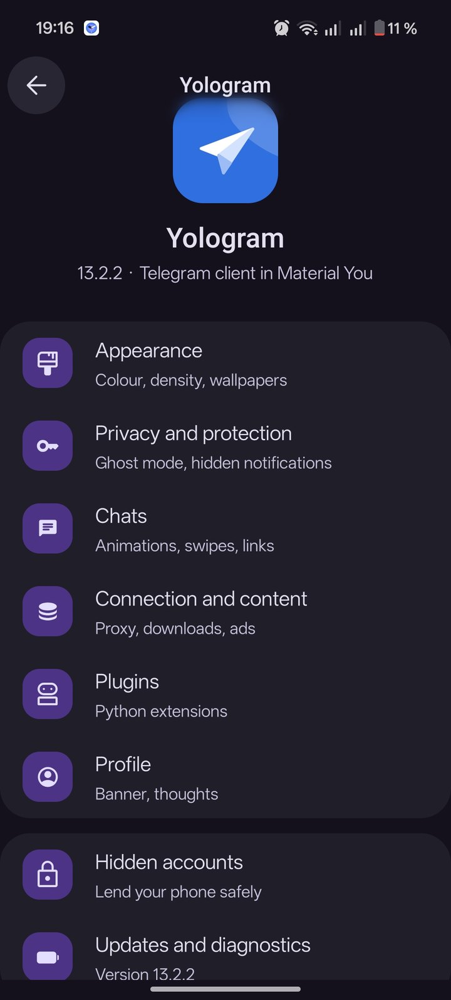
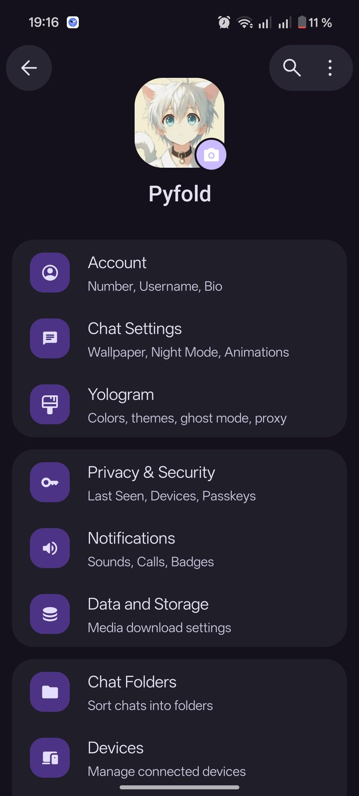
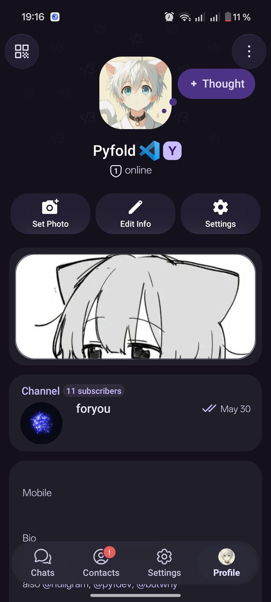

  

## Скриншоты

  
  
  
  

## Возможности

- Material You: цвет темы, плотность, скругление, AMOLED
- Режим призрака: без отметок о прочтении, набора текста и статуса «в сети»
- Сохранение удалённых сообщений, истории правок и исчезающих фото
- Мысли, баннер профиля, обои главного экрана
- WebSocket-прокси, очистка ссылок, экспорт чата
- Скрытие текста в уведомлениях
- Шесть значков приложения, пружинящие анимации, звонки и панель ввода в стиле Material You
- До 16 аккаунтов, без рекламы, быстрые загрузки

Настройки: **Настройки → Yologram**.

## Диагностика

Приложение отправляет на сервер Yologram анонимные отчёты об ошибках и статистику: случайный идентификатор установки, версию, модель устройства, включённые функции и стек ошибки. Идентификаторы Telegram, номера, имена пользователей и содержимое чатов не передаются. Отключается в настройках Yologram.

## Значки

Значки интерфейса — Material Symbols Rounded (вес 500) от Google, лицензия Apache 2.0.

## Лицензия

GPL v2. Основан на [Telegram для Android](https://github.com/DrKLO/Telegram), неофициальный клиент.
